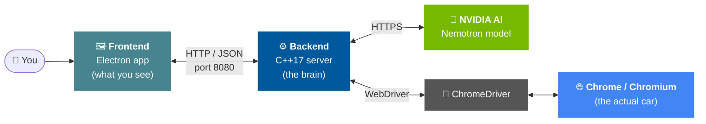
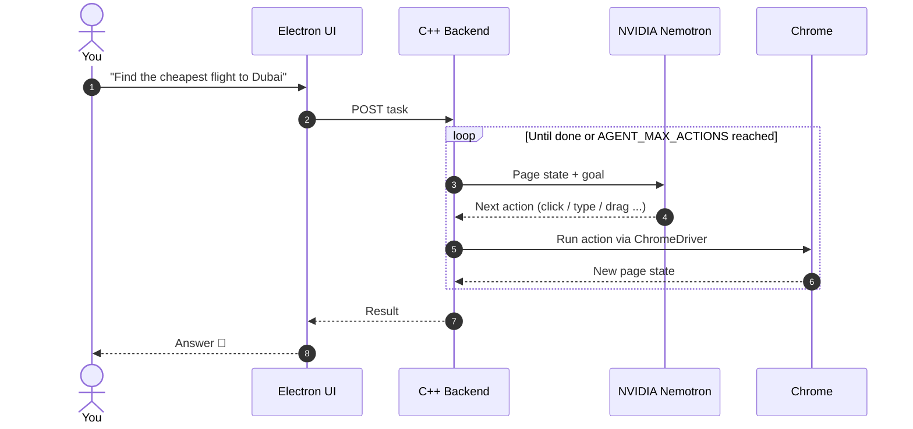
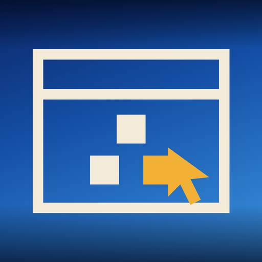

<div align="center">

# Automata
 
### The AI browser agent that lives on your desktop
 
Chat with an AI, let it drive a real Chrome browser, and watch it draw on web pages, all from one app.
 
<br/>
[](https://github.com/muzammil-max/Automata/releases)
[](#-license)
[](https://github.com/muzammil-max/Automata/releases)
 


 
<br/>
**Supported platforms**
 


 
</div>
---
 
## 📑 Table of Contents
 
- [✨ What Can It Do?](#-what-can-it-do)
- [🖥️ The Big Picture](#️-the-big-picture)
- [🚀 Quick Start (Windows)](#-quick-start-windows)
- [🧰 Supported Platforms](#-supported-platforms)
- [🔑 Environment Variables](#-environment-variables)
- [🗂️ Where Your Data Lives](#️-where-your-data-lives)
- [🛠️ Building from Source](#️-building-from-source)
- [🩺 Troubleshooting](#-troubleshooting)
- [📸 Screenshots & Icons](#-screenshots--icons)
- [📚 Documentation](#-documentation)
- [📜 License](#-license)
---
 
## ✨ What Can It Do?
 
<table>
  <tr>
    <td align="center" width="33%">
      <h3>💬 Chat</h3>
      Talk to an AI brain powered by <b>NVIDIA Nemotron</b> like a friendly assistant. Works the moment you open the app.
    </td>
    <td align="center" width="33%">
      <h3>🌐 Browse</h3>
      Drives a <b>real Chrome / Chromium</b> browser through ChromeDriver to complete tasks on the internet for you.
    </td>
    <td align="center" width="33%">
      <h3>🎨 Draw</h3>
      Uses a canvas-aware <code>drag</code> action to <b>draw on web pages</b> during tasks.
    </td>
  </tr>
</table>
| | Feature | Details |
| :-: | --- | --- |
| ⚡ | **Zero-install option** | Single portable `.exe`, just double-click. |
| 🔒 | **Local-first** | Backend runs on `127.0.0.1:8080`, so your chats stay on your machine. |
| 🧠 | **Agent loop** | The AI plans, the browser acts, and it repeats up to a configurable action limit. |
| 💾 | **Session history** | Every chat is saved as JSON so you can pick up where you left off. |
| 📦 | **Batteries included** | Backend and ChromeDriver are bundled, so there is nothing else to install. |
 
---
 
## 🖥️ The Big Picture
 

 
| Layer | Role |
| --- | --- |
| **Frontend** | The desktop window you click: splash screen → chat → drawing tool. Built with Electron. |
| **Backend** | A C++ program running a local HTTP server (`httplib`) on port `8080`. |
| **Agent** | The part of the backend that talks to the AI and tells the browser what to do. |
 
<details>
<summary><b>🔁 How a browser task works (simplified)</b></summary>

 
</details>
---
 
## 🚀 Quick Start (Windows)
 
### 1️⃣ Download
 
Grab the latest build from the **[Releases page](https://github.com/muzammil-max/Automata/releases)**:
 
| Build | Size | Best for |
| --- | :-: | --- |
| 📦 **`Automata-Portable-1.0.0.exe`** | 84.5 MB | Single file, no install. Just double-click. |
| 💿 **`Automata-Setup-1.0.0.exe`** | 92.7 MB | Full installer with Start Menu and Desktop shortcuts. |
 
### 2️⃣ One-time setup
 
| Step | What to do |
| :-: | --- |
| **1** | Run one of the EXEs. On first launch SmartScreen may warn you (unsigned build). Click **More info → Run anyway**. |
| **2** | Install **[Google Chrome](https://www.google.com/chrome/)**. Its major version should roughly match the bundled ChromeDriver. |
| **3** | Set your AI key (see below), then restart the app. Get a free key at [build.nvidia.com](https://build.nvidia.com). |
| **4** | Allow the app through **Windows Firewall** when prompted (localhost only). |
 
**Set the API key** (pick one):
 
```bat
:: Persistent, recommended. Open a NEW terminal afterwards.
setx NVIDIA_API_KEY "nvapi-xxxxxxxxxxxxxxxx"
 
:: Current terminal session only
set NVIDIA_API_KEY=nvapi-xxxxxxxxxxxxxxxx
```
 
> 💡 **Tip:** Chat works immediately. Chrome is only needed for browser tasks.
 
### 3️⃣ What happens when you launch it
 
The packaged `Automata.exe` automatically:
 
1. ▶️ Starts the bundled C++ backend (`api_server.exe`), built natively for Windows with WinHTTP.
2. ▶️ Starts the bundled `chromedriver.exe` if available.
3. 🖼️ Loads the chat UI from the backend at `http://127.0.0.1:8080/`.
---
 
## 🧰 Supported Platforms
 
<div align="center">
| | Platform | Status | Notes |
| :-: | --- | :-: | --- |
|  | **Windows** (x64) | ✅ **Fully supported** | Native build via MSYS2 or zig cross-compile. Portable and installer. |
|  | **Linux** (x64) | ⚠️ **Dev only** | Backend uses Linux `curl`. Run with the `Automata` launcher script. |
|  | **macOS** | ❌ **Not supported** | Cross-building from macOS is supported, but the app itself does not run on it. |
 
</div>
---
 
## 🔑 Environment Variables
 
| Variable | Purpose | Default |
| --- | --- | --- |
| `NVIDIA_API_KEY` | 🔐 NVIDIA AI key (the agent's brain). **Required.** | none |
| `CHROME_PATH` / `CHROMIUM_PATH` | Browser binary to drive. | Auto-detected |
| `CHROMEDRIVER_URL` | ChromeDriver address. | `http://127.0.0.1:9515` |
| `CHROMEDRIVER_BIN` | ChromeDriver binary. | Auto-detected |
| `AGENT_MAX_ACTIONS` | Max actions the agent may take per task. | `100` |
 
---
 
## 🗂️ Where Your Data Lives
 
```text
%APPDATA%\Automata\
├── storage\
│   └── sessions\*.json     ← 💬 chat history
├── automata.log            ← 📝 app logs
└── backend.log             ← ⚙️ backend output
```
 
---
 
## 🛠️ Building from Source
 
<details>
<summary><b>🪟 Native Windows build (on Windows)</b></summary>
**Requires:** [Node.js 18+](https://nodejs.org) and [MSYS2](https://www.msys2.org) with `mingw-w64-x86_64-gcc`.
 
```bat
cd build\windows
build.bat          REM backend + chromedriver + installer/portable exe
run.bat            REM development mode (backend + Electron)
```
 
</details>
<details>
<summary><b>🐧🍎 Cross-build from Linux / macOS</b></summary>
```sh
cd build/windows
chmod +x *.sh
./cross-build.sh   # uses zig cc/c++ to build api_server.exe for Windows
```
 
</details>
**📁 Output**
 
```text
build/windows/dist/
├── Automata-Portable-1.0.0.exe   ← single double-click exe
└── Automata-Setup-1.0.0.exe      ← installer
```
 
Full instructions: [`build/windows/README.md`](build/windows/README.md)
 
---
 
## 🩺 Troubleshooting
 
<details>
<summary><b>The AI doesn't answer / "missing API key"</b></summary>
Make sure `NVIDIA_API_KEY` is set, then **fully restart** the app. If you used `setx`, open a new terminal first.
</details>
<details>
<summary><b>Browser tasks fail to start</b></summary>
Install Google Chrome, and keep its major version close to the bundled ChromeDriver. You can also point to a specific browser with `CHROME_PATH`.
</details>
<details>
<summary><b>Windows SmartScreen blocks the app</b></summary>
The build is unsigned. Click **More info → Run anyway**.
</details>
<details>
<summary><b>The UI is blank or won't load</b></summary>
Check that nothing else is using port `8080`, and look at `%APPDATA%\Automata\backend.log` for errors.
</details>
---
 
## 📸 Screenshots & Icons
 
> Add your app screenshots to `docs/screenshots/` and they will show up here.
 
<div align="center">
| 🪟 Windows window icon | 🐧 Linux icon |
| :-: | :-: |
|  |  |
 
<sub>Captured from the packaged Windows build.</sub>
 
</div>
---
 
## 📚 Documentation
 
| Doc | What's inside |
| --- | --- |
| 📖 [`docs/BACKEND_GUIDE.md`](docs/BACKEND_GUIDE.md) | Beginner-friendly walkthrough of every backend file. |
| 🎨 [`backend/README_DRAG_TOOL.md`](backend/README_DRAG_TOOL.md) | Drawing tool details. |
| 🪟 [`build/windows/README.md`](build/windows/README.md) | Windows build instructions. |
 
---
 
## 📜 License
 
Released under the **MIT License**.
 
<div align="center">
<sub>Made with ❤️ by <a href="https://github.com/muzammil-max">muzammil-max</a> · If Automata helps you, give it a ⭐</sub>
 
</div>
 
