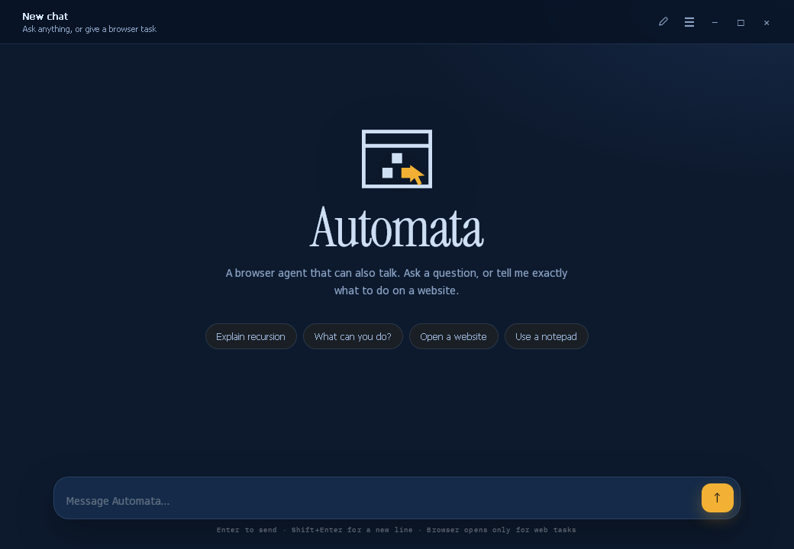
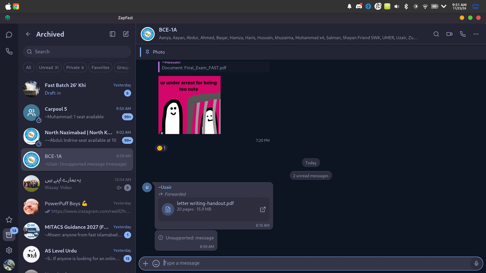

# 🤖 Automata — AI Browser Agent

Automata is a desktop AI agent that lives in your computer. It can:

1. **Chat** with an AI brain (NVIDIA Nemotron) like a friendly assistant. 💬
2. **Drive a real web browser** (Chrome / Chromium via ChromeDriver) and complete tasks on the internet. 🌐🖱️
3. **Draw on web pages** using a canvas-aware action (`drag`) during tasks. 🎨🖍️

---

## 🖥️ The Big Picture

```
+----------------------+         HTTP/JSON         +----------------------+
|   FRONTEND (Electron)|  <-------------------> |   BACKEND (C++17)    |
|   (what you see)     |        (port 8080)       |   (the brain)         |
|   main.js, index,   |                           |   api/, agent/,      |
|   css, js, boot...) |                           |   browser/, parser/,  |
+----------------------+                           |   storage/, instruct. |
                                                   +----------------------+
                                                                |
                                                                | ChromeDriver (WebDriver)
                                                                v
                                                      +----------------------+
                                                      |   CHROME / CHROMIUM |
                                                      |   (the actual car)   |
                                                      +----------------------+
                                                                |
                                                                | NVIDIA API (the AI brain
                                                                |  that thinks & answers)
                                                                v
                                                      +----------------------+
                                                      |      NVIDIA AI       |
                                                      | (nemotron model)     |
                                                      +----------------------+
```

- **Frontend** = the desktop window you click. Electron app. Splash → Chat. Drawing tool. 🎨
- **Backend** = C++ program that runs a local HTTP server (httplib) on port `8080`.
- **Agent** = the part of the backend that talks to the AI and tells the browser what to do.

---

## 📦 Windows Build (Recommended)

### Download

Grab the latest Windows build from the **[Releases page](https://github.com/muzammil-max/Automata/releases)**:

- **`Automata-Portable-1.0.0.exe`** (84.5 MB) — single file, no install. Just double-click.
- **`Automata-Setup-1.0.0.exe`** (92.7 MB) — installer with Start Menu + Desktop shortcuts.

### How it works

The packaged `Automata.exe` automatically:

1. Starts the bundled C++ backend (`api_server.exe`) — Windows native (WinHTTP).
2. Starts the bundled ChromeDriver (`chromedriver.exe`) if available.
3. Loads the chat UI from the backend at `http://127.0.0.1:8080/`.

Both backend and driver are already compiled into the installer — **nothing to install separately**.

### One-time setup on Windows

| Step | What to do |
| --- | --- |
| 1 | Run one of the EXEs. On first run, SmartScreen may show **"More info → Run anyway"** (unsigned build). |
| 2 | Install **Google Chrome** — its major version should roughly match the bundled ChromeDriver. |
| 3 | Set the AI key: `set NVIDIA_API_KEY=nvapi-...` (get one at https://build.nvidia.com) and restart the app. |
| 4 | Allow the app through **Windows Firewall** when prompted (localhost only). |

Chat works immediately. For browser tasks you need Chrome installed.

### Where data is stored

```
%APPDATA%\Automata\
  storage\sessions\*.json   <- chat history
  automata.log               <- app logs
  backend.log                <- backend output
```

---

## 🛠️ Building from Source

### Native Windows build (on Windows)

Requires: [Node.js 18+](https://nodejs.org), [MSYS2](https://www.msys2.org) with `mingw-w64-x86_64-gcc`.

```bat
cd build\windows
build.bat          REM backend + chromedriver + installer/portable exe
run.bat            REM development mode (backend + Electron)
```

### Cross-build from Linux / macOS

```sh
cd build/windows
chmod +x *.sh
./cross-build.sh   # uses zig cc/c++ -> builds api_server.exe for Windows
```

### Output

```
build/windows/dist/
  Automata-Portable-1.0.0.exe   -> single double-click exe
  Automata-Setup-1.0.0.exe      -> installer
```

Full instructions: [`build/windows/README.md`](build/windows/README.md)

---

## 🧰 Supported Platforms

| Platform | State |
| --- | --- |
| **Windows** (x64) | ✅ **Fully supported** — native build via MSYS2 / zig cross-compile; portable + installer. |
| **Linux** (x64) | ⚠️ Dev only — backend via Linux `curl`; `Automata` launcher script. |
| **macOS** | ❌ Not supported. |

---

## 🔑 Environment Variables

| Variable | Purpose | Default |
| --- | --- | --- |
| `NVIDIA_API_KEY` | NVIDIA AI key (agent brain). Required. | – |
| `CHROME_PATH` / `CHROMIUM_PATH` | Browser binary to drive. | Auto-detected |
| `CHROMEDRIVER_URL` | ChromeDriver address. | `http://127.0.0.1:9515` |
| `CHROMEDRIVER_BIN` | ChromeDriver binary. | Auto-detected |
| `AGENT_MAX_ACTIONS` | Max actions per task. | `100` |

---

## 📸 Screenshots & Icons

### 🖼️ Visuals

**Windows — main chat window (packaged build):**



**Windows — splash screen:**



### 🪟 Icons

| Windows window icon | Linux icon |
| --- | --- |
|  |  |

Captured from the packaged Windows build.

---

## 📚 Documentation

- [`docs/BACKEND_GUIDE.md`](docs/BACKEND_GUIDE.md) — detailed, beginner-friendly walkthrough of every backend file.
- [`backend/README_DRAG_TOOL.md`](backend/README_DRAG_TOOL.md) — drawing tool details.
- [`build/windows/README.md`](build/windows/README.md) — Windows build instructions.

---

## 📜 License

MIT
