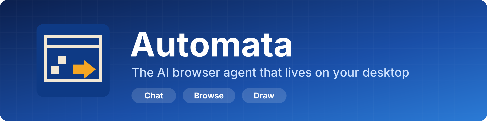

<p align="center">
  
</p>

<p align="center">
  Chat with an AI, let it drive a browser for you!
</p>

<p align="center">
  <a href="https://github.com/muzammil-max/Automata/releases"></a>
  <a href="#-license"></a>
  <a href="https://github.com/muzammil-max/Automata/releases"></a>
</p>

<p align="center">
  
  
  
  
</p>

<p align="center"><b>Supported platforms</b></p>

<p align="center">
  
  
  
</p>

---

## 🖥️ The Big Picture

```
+----------------------+         HTTP/JSON         +----------------------+
|  RUST UI (egui)      |  <------------------->   |   BACKEND (C++17)    |
|  native desktop app  |        (port 8080)       |   api/, agent/,      |
|  rust/automata-ui    |                           |   browser/, parser/, |
+----------------------+                           |   settings/, storage |
                                                   +----------------------+
                                                                |
                                                   WebDriver wire protocol
                                                                v
                                                   +----------------------+
                                                   | automata-browser     |
                                                   | (Rust CDP engine)    |
                                                   | port 9515            |
                                                   +----------------------+
                                                                |
                                                                | DevT ools Protocol
                                                                v
                                                   +----------------------+
                                                   |   CHROME / CHROMIUM |
                                                   +----------------------+

                          AI provider (cloud BYOK or local) <--- backend
```

- **UI** = native Rust desktop window (egui/eframe). Fast, no browser engine, no Electron.
- **Backend** = C++ program running a local HTTP server (httplib) on port `8080`.
- **Browser engine** = Rust sidecar speaking the WebDriver wire protocol on port `9515`, implemented directly on the Chrome DevTools Protocol with `chromiumoxide`. It can also be replaced by a running ChromeDriver.
- **Agent** = the part of the backend that talks to the AI and tells the browser what to do.

The Electron frontend in `frontend/` is kept for the existing Windows packaging pipeline; the new native UI lives in `rust/automata-ui`.

---

## 🔑 Providers, BYOK and Local Models

Settings are stored in:

- Linux/macOS: `~/.config/automata/config.json` (or `$XDG_CONFIG_HOME/automata/config.json`)
- Windows: `%APPDATA%\Automata\config.json`

The file is written with owner-only permissions on POSIX. API keys can also come from environment variables, so you never have to store them.

| Provider | Default model | Base URL | Key |
| --- | --- | --- | --- |
| `nvidia` | `nvidia/nemotron-3.5-super-vl-120b-a12b` | `https://integrate.api.nvidia.com/v1` | `NVIDIA_API_KEY` |
| `openai` | `gpt-4o-mini` | `https://api.openai.com/v1` | `OPENAI_API_KEY` |
| `anthropic` | `claude-3-5-sonnet-latest` | `https://api.anthropic.com/v1` | `ANTHROPIC_API_KEY` |
| `gemini` | `gemini-1.5-flash` | `https://generativelanguage.googleapis.com/v1beta` | `GEMINI_API_KEY` |
| `groq` | `llama-3.3-70b-versatile` | `https://api.groq.com/openai/v1` | `GROQ_API_KEY` |
| `openrouter` | `openai/gpt-4o-mini` | `https://openrouter.ai/api/v1` | `OPENROUTER_API_KEY` |
| `ollama` | `llama3.1` | `http://127.0.0.1:11434/v1` | none (local) |
| `lmstudio` | `local-model` | `http://127.0.0.1:1234/v1` | none (local) |
| `custom` | any | your OpenAI-compatible URL | optional |

Settings API:

```
GET  /api/settings
PUT  /api/settings
GET  /api/providers
```

Example:

```sh
curl -X PUT http://127.0.0.1:8080/api/settings \
  -H 'Content-Type: application/json' \
  -d '{"provider":"ollama","model":"llama3.1",
       "base_url":"http://127.0.0.1:11434/v1",
       "temperature":0.7,"max_tokens":4096,"reasoning_effort":"high"}'
```

---

## 🧰 Browser Tools

The model can choose these actions (see `backend/instructions/instruction.cpp`):

`navigate`, `go_back`, `go_forward`, `new_tab`, `reload`, `tabs`, `switch_tab`,
`close_tab`, `click`, `double_click`, `right_click`, `hover`, `focus`, `clear`,
`check`, `uncheck`, `type`, `extract`, `get_html`, `evaluate`, `scroll`,
`scroll_into_view`, `press`, `select`, `wait`, `wait_for`, `wait_for_navigation`,
`drag`, `switch_frame`, `upload_file`, `screenshot`, `cookies`, `set_cookie`,
`delete_cookies`, `set_window_size`, `remember`, `close`, `finish`.

---

## 🛠️ Building from Source

### Prerequisites

- C++17 compiler (g++/clang++), `libcurl`, `pthread`
- Rust 1.80+ and Cargo
- Node.js 18+ only if you want the legacy Electron UI
- Google Chrome or Chromium for browser tasks

### Native Linux/macOS development build

```sh
# 1. Rust UI + CDP browser engine
cd rust
cargo build --release

# 2. C++ backend
cd ../backend
g++ -std=c++17 -O2 -pthread \
  main.cpp api/api_server.cpp api/nvidia_client.cpp \
  api/openai_client.cpp api/anthropic_client.cpp api/gemini_client.cpp \
  api/ai_provider_factory.cpp api/http_client.cpp \
  agent/agent.cpp browser/browser_controller.cpp parser/parser.cpp \
  storage/session_storage.cpp settings/llm_settings.cpp \
  instructions/instruction.cpp \
  -lcurl -o api_server

# 3. Run the native UI (it starts the backend and browser engine)
../rust/target/release/automata-ui
```

You can also start the pieces manually:

```sh
./backend/api_server                 # port 8080
./rust/target/release/automata-browser   # port 9515
```

### Windows build (legacy packaging)

```bat
cd build\windows
build.bat          REM backend + chromedriver + Electron installer/portable exe
run.bat            REM development mode
```

Cross-build the backend from Linux/macOS:

```sh
cd build/windows
chmod +x *.sh
./build-backend.sh
```

The backend source list in `build/windows/build-backend.sh` already includes the
new provider and settings files.

---

## 🧰 Supported Platforms

| Platform | State |
| --- | --- |
| **Linux** (x64) | ✅ Native Rust UI + C++ backend + Rust CDP engine. |
| **Windows** (x64) | ✅ Backend cross-build supported; Electron packaging retained. |
| **macOS** | ⚠️ Backend uses libcurl and may build; not officially tested. |

---

## 🔑 Environment Variables

| Variable | Purpose | Default |
| --- | --- | --- |
| `NVIDIA_API_KEY`, `OPENAI_API_KEY`, `ANTHROPIC_API_KEY`, `GEMINI_API_KEY`, `GROQ_API_KEY`, `OPENROUTER_API_KEY` | Provider keys when no key is stored in settings. | – |
| `AUTOMATA_BACKEND` | Path to the `api_server` binary for the Rust UI. | Auto-detected |
| `AUTOMATA_BROWSER_BIN` | Path to the `automata-browser` binary. | Auto-detected |
| `AUTOMATA_BROWSER_PORT` | Port for the Rust CDP engine. | `9515` |
| `CHROME_PATH` / `CHROMIUM_PATH` | Browser binary to drive. | Auto-detected |
| `CHROMEDRIVER_URL` | Driver address (Rust engine or ChromeDriver). | `http://127.0.0.1:9515` |
| `CHROMEDRIVER_BIN` | ChromeDriver binary (legacy path). | Auto-detected |
| `AUTOMATA_HOME_URL` | Page opened when the browser starts. | `https://automata-app.vercel.app` |
| `AGENT_MAX_ACTIONS` | Max actions per task. | `100` |
| `AGENT_TYPE_CHUNK` | Bytes per typing chunk (40–2000). | `40` |

---

## 📸 Screenshots & Icons

### 🖼️ Visuals

**Windows — main chat window (packaged build):**


**Windows — splash screen:**


### 🪟 Icons

| Windows window icon | Linux icon |
| --- | --- |
|  |  |

Captured from the packaged Windows build.

---

## 📚 Documentation

- [`docs/BACKEND_GUIDE.md`](docs/BACKEND_GUIDE.md) — detailed walkthrough of every backend file.
- [`backend/README_DRAG_TOOL.md`](backend/README_DRAG_TOOL.md) — drawing tool details.
- [`build/windows/README.md`](build/windows/README.md) — Windows build instructions.

---

## 📜 License

MIT
